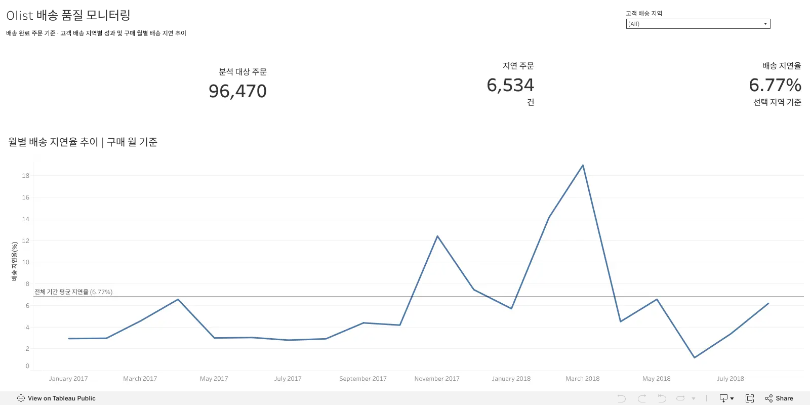
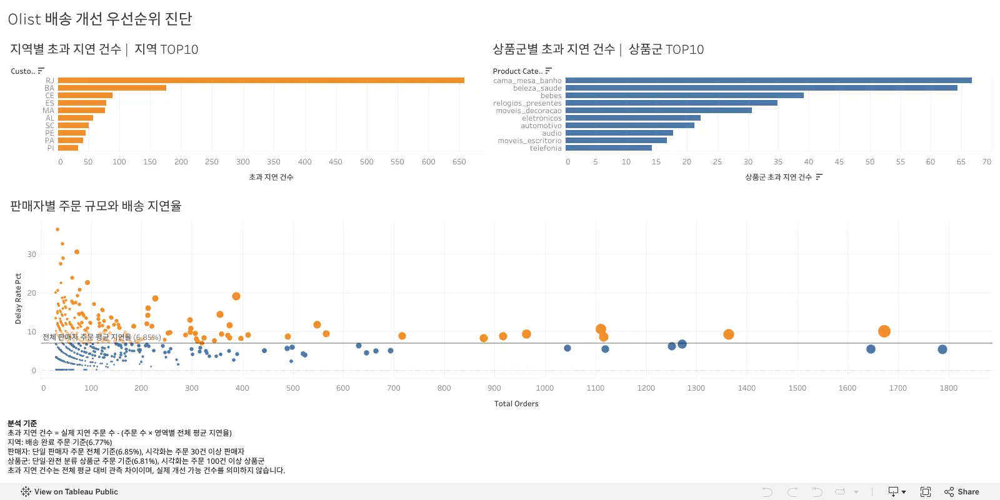

# Project A. Olist 배송 품질 진단 및 개선 우선순위 분석

**SQL · Python · 통계 분석 · Tableau**

[배송 품질 모니터링](https://public.tableau.com/views/Olist_17945549244590/Olist) · [배송 개선 우선순위 진단](https://public.tableau.com/views/Olist_17945549244590/Olist_1)

## 1. 프로젝트 개요

이커머스에서 배송 지연율은 중요한 운영 지표이지만, 전체 평균만으로는 어떤 영역을 우선적으로 개선해야 하는지 판단하기 어렵습니다.

본 프로젝트에서는 브라질 Olist 이커머스 데이터를 활용하여 **배송 지연과 고객 평가의 연관성을 검토하고, 지역·판매자·상품군별 배송 품질을 비교하여 운영 개선 우선순위를 제안**했습니다.

### 핵심 분석 질문

1. 배송 지연과 낮은 고객 평점 사이에는 어떤 연관성이 있는가?
2. 배송 지연율과 주문 규모를 함께 고려했을 때 우선 점검해야 할 영역은 어디인가?
3. 배송 품질은 지역·판매자·상품군 및 구매 시기에 따라 어떻게 달라지는가?

## 2. 분석 환경 및 기술

| 영역 | 사용 기술 |
|---|---|
| 데이터베이스 | PostgreSQL |
| 데이터 추출 및 가공 | SQL, CTE, Window Function, View |
| 탐색적 분석 | Python, pandas, NumPy |
| 통계 분석 | SciPy, statsmodels |
| 시각화 | Matplotlib, Seaborn, Tableau |
| 환경 및 재현성 | Conda, python-dotenv, requirements.txt |

**분석 과정**

1. **데이터 검증:** 원본 테이블의 참조 무결성, 결측 및 주문 단위 중복 구조 확인
2. **EDA 및 통계 분석:** 배송 지연 일수 분포, 고객 평가와의 연관성 분석
3. **분석용 데이터 구축:** 주문·지역·판매자·상품군 단위 PostgreSQL View 생성
4. **운영 진단:** 초과 지연 건수를 활용해 우선 점검 후보 도출
5. **대시보드 제작:** Tableau에서 배송 품질 현황과 개선 우선순위 시각화

## 3. 데이터 및 핵심 지표

분석에는 Olist 공개 이커머스 데이터의 주문, 주문 상품, 판매자, 고객, 상품 및 리뷰 정보를 사용했습니다.

배송 품질 분석은 배송 완료 상태이며 실제 배송일과 예상 배송일이 모두 존재하는 주문을 대상으로 합니다.

| 핵심 지표 | 분석 결과 |
|---|---:|
| 배송 품질 분석 주문 | 96,470건 |
| 배송 지연 주문 | 6,534건 |
| 전체 배송 지연율 | 6.77% |
| 지연 주문의 평균 지연 일수 | 10.62일 |
| 최대 지연 일수 | 188일 |
| 유효 리뷰 주문 | 95,299건 |

**지표 정의**

- 배송 지연: 실제 배송일이 예상 배송일보다 늦은 경우(날짜 기준)
- 저평점: 리뷰 점수 1~2점
- 유효 리뷰: 주문당 리뷰가 정확히 1건인 경우

배송 지연율과 저평점 비율은 분석 대상 및 분모를 구분하여 계산했습니다.

## 4. 주요 분석 결과

### 4.1. 배송 지연과 고객 평가의 연관성

배송 지연 정도에 따라 저평점 비율에서 큰 차이가 관측됐습니다.

| 배송 구분 | 저평점 비율 |
|---|---:|
| 정시·조기 배송 | 9.25% |
| 1~7일 지연 | 49.30% |
| 8~22일 지연 | 80.48% |
| 23일 이상 지연 | 75.28% |

카이제곱 독립성 검정에서 배송 지연 구간과 저평점 여부 사이에 통계적으로 유의한 연관성이 확인됐으며, Cramér's V는 약 **0.413**으로 나타났습니다.

다만 지연 기간에 따른 저평점 비율이 모든 구간에서 단조 증가하지는 않았으며, 관측 자료만으로 인과관계를 확정할 수 없습니다.

### 4.2. 지역별 배송 개선 우선순위

단순 지연율뿐 아니라 **초과 지연 건수(Excess Delayed Orders)**를 활용해 운영 점검 후보를 비교했습니다.

초과 지연 건수 = 실제 지연 주문 수 − (해당 집단 주문 수 × 전체 기준 지연율)

| 고객 지역 | 배송 지연율 | 초과 지연 건수 |
|---|---:|---:|
| RJ | 12.11% | +658.5 |
| BA | 12.16% | +175.5 |
| CE | 13.76% | +89.4 |

RJ는 전체 평균보다 지연율이 높으면서 초과 지연 규모도 가장 커 우선적인 운영 점검 후보로 나타났습니다.

### 4.3. 판매자별 배송 품질

주문 30건 이상인 판매자 615명이 전체 단일 판매자 주문의 **83.17%**를 담당했습니다.

초과 지연 건수 상위 10개 판매자 중 8개는 SP 소재였지만, SP 판매자의 주문량 자체가 크다는 점을 함께 고려해야 합니다.

SP 소재 판매자의 배송 목적지를 비교하면 다음과 같습니다.

| 배송 경로 | 지연율 |
|---|---:|
| SP → SP | 4.48% |
| SP → RJ | 14.29% |

이는 판매자의 소재지만이 아니라 **배송 목적지와의 조합을 고려한 추가 점검**이 필요함을 시사합니다.

### 4.4. 상품군별 개선 우선순위

초과 지연 건수를 기준으로 `cama_mesa_banho`, `beleza_saude`, `bebes`가 주요 점검 후보로 나타났습니다.

분석에서는 상품군이 하나로 명확하게 분류되고 상품군 정보가 누락되지 않은 주문만 사용했습니다.

### 4.5. 월별 배송 품질 변화

2017년 11월과 2018년 2~3월에 지연율 상승이 관측됐으며, 특히 **2018년 3월에는 배송 지연율이 18.96%**로 나타났습니다.

지역별 비교에서도 여러 지역에서 지연율이 함께 상승하는 현상이 확인됐습니다. 다만 해당 시기의 배송 품질 악화 원인은 본 데이터만으로 식별할 수 없습니다.

## 5. Tableau 대시보드

**[배송 품질 모니터링](https://public.tableau.com/views/Olist_17945549244590/Olist) · [배송 개선 우선순위 진단](https://public.tableau.com/views/Olist_17945549244590/Olist_1)**

두 개의 대시보드로 구성했습니다.

| 대시보드 | 주요 내용 |
|---|---|
| 01. 배송 품질 현황 및 추이 | 전체 KPI, 월별 배송 지연율, 고객 지역 필터 |
| 02. 배송 개선 우선순위 진단 | 지역·상품군별 초과 지연 건수, 판매자별 주문량·지연율 |





## 6. 운영 개선 제안

분석 결과를 근거로 다음과 같은 운영 방향을 제안합니다.

- **지역:** RJ 등 초과 지연 규모가 큰 지역을 우선 점검
- **배송 경로:** SP 소재 판매자에서 특정 고객 지역으로 배송하는 주문의 지연 현황 추가 조사
- **상품군:** 주문 규모와 지연율이 함께 높은 상품군 우선 모니터링
- **시기:** 월별 배송 지연율 급등을 감지하는 모니터링 지표 운영

우선순위는 운영 점검의 출발점이며, 구체적인 개선 조치와 효과는 추가적인 원인 분석 및 검증이 필요합니다.

## 7. 분석 한계

- 배송 완료 주문만 포함되어 미배송·취소 주문의 경험을 대표하지 않습니다.
- 리뷰가 없거나 복수 리뷰가 있는 주문을 평점 분석에서 제외했습니다.
- 판매자·상품군 분석은 중복 집계를 방지하기 위해 일부 주문을 제외하므로 전체 KPI와 모집단이 다릅니다.
- 초과 지연 건수는 평균 대비 관측된 차이이지 실제 개선 가능 건수가 아닙니다.
- 배송 지연과 저평점의 연관성은 인과적 효과를 의미하지 않습니다.

## 8. 분석 파일

- SQL — [데이터 검증](sql/01_data_validation.sql) · [분석용 뷰](sql/03_analysis_views.sql) · [운영 진단](sql/04_business_analysis.sql)
- [배송 지연 분석 Notebook](notebooks/02_delivery_distribution.ipynb)
- [분석 보고서](reports/analysis_report.md)

## 데이터 준비

[Brazilian E-Commerce Public Dataset by Olist](https://www.kaggle.com/datasets/olistbr/brazilian-ecommerce)에서 CSV를 받아 PostgreSQL의 `olist` 데이터베이스를 준비합니다. 첫 행을 헤더로 사용하고 아래 이름으로 `public` 스키마에 적재합니다.

| CSV | 테이블 |
|---|---|
| `olist_customers_dataset.csv` | `customers` |
| `olist_geolocation_dataset.csv` | `geolocation` |
| `olist_order_items_dataset.csv` | `order_items` |
| `olist_order_payments_dataset.csv` | `payments` |
| `olist_order_reviews_dataset.csv` | `reviews` |
| `olist_orders_dataset.csv` | `orders` |
| `olist_products_dataset.csv` | `products` |
| `olist_sellers_dataset.csv` | `sellers` |
| `product_category_name_translation.csv` | `product_category_name_translation` |

압축을 풀어 CSV 9개가 들어 있는 폴더에서 터미널을 엽니다. PostgreSQL을 실행한 상태에서 아래 명령을 실행합니다. `postgres`는 로컬 접속 계정으로, SQL 파일 경로는 이 저장소를 내려받은 위치에 맞게 바꿉니다. 이미 같은 이름의 테이블이 있다면 별도의 빈 데이터베이스에서 실행하고 `DB_NAME`도 그 이름으로 설정합니다.

```powershell
$env:PGCLIENTENCODING = "UTF8"
createdb -h localhost -U postgres olist
psql -h localhost -U postgres -d olist -f "D:/portfolio/olist_portfolio/projects/A_delivery_quality/sql/00_load_data.sql"
```

[테이블 생성 및 CSV 적재 SQL](sql/00_load_data.sql)은 9개 테이블을 한 트랜잭션에서 생성하고 적재합니다. 적재가 끝나면 [데이터 검증 SQL](sql/01_data_validation.sql)에서 배송 분석 대상 96,470건과 지연 주문 6,534건을 확인합니다.

저장소 루트에서 `python -m pip install -r requirements.txt`를 실행합니다. 루트의 `.env`에 아래 항목을 만들고 로컬 데이터베이스 접속값을 채웁니다.

```dotenv
DB_USER=
DB_PASSWORD=
DB_HOST=localhost
DB_PORT=5432
DB_NAME=olist
```

이후 [분석 보고서의 실행 순서](reports/analysis_report.md#93-실행-순서)를 따릅니다.
