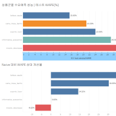
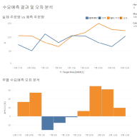

# Olist E-Commerce | 상품군별 주간 수요예측

> 5개 상품군의 1~4주 주문 상품 수량을 예측하고, 학습 구간에서 선정한 모델을 마지막 12주로 평가했습니다.

## 1. 프로젝트 개요

전자상거래 환경에서 상품군별 수요를 미리 파악하는 것은 재고 및 운영 계획을 수립하는 데 중요합니다.

본 프로젝트에서는 Olist 전자상거래 데이터를 활용하여 **5개 주요 상품군의 향후 1~4주 주문 상품 수량을 예측**했습니다.

단일 모델을 모든 상품군에 적용하는 대신, 상품군별 시계열 특성을 분석하고 Naive·이동평균·ETS·ARIMA 모델을 비교하여 적합한 예측 방법을 선정했습니다.

### 주요 목표
- 상품군별 주간 주문 수량의 추세와 변동 특성 파악
- 13개 예측 모델의 성능 비교
- 시간 순서를 고려한 Rolling-origin 검증
- 미사용 테스트 기간에서 예측 성능 및 실패 사례 분석

## 2. 데이터 및 분석 환경

**데이터:** Olist Brazilian E-Commerce Dataset

**예측 대상:** 주문 상태와 관계없이 집계한 상품군별 주간 주문 상품 수량

**분석 기간:** 주 시작일 2017-03-06 ~ 2018-08-13 (마지막 주 종료일 2018-08-19)

**분석 규모:** 5개 상품군 × 76주 = 380개 관측값

**기술 스택**
- PostgreSQL: 데이터 집계 및 SQL View
- Python / Pandas: 데이터 처리 및 분석
- Statsmodels: ETS·ARIMA 모델링
- Scikit-learn: 예측 성능 평가
- Tableau: 예측 결과 및 오차 시각화

## 3. 분석 및 모델링 방법

### 시계열 탐색

상품군별 주간 주문량의 추세와 변동을 시각화하고, ACF·PACF 및 ADF 검정을 통해 시계열 특성을 검토했습니다.

### 비교 모델

| 모델 유형 | 후보 |
|---|---|
| Baseline | Naive, MA4 |
| ETS | ETS(A,N,N), ETS(A,A,N), ETS(A,Ad,N) |
| ARIMA | p∈{0,1}, d∈{0,1}, q∈{0,1}의 8개 조합 |

### 검증 설계

- 최초 64주: 학습 및 모델 선택
- 마지막 12주: 최종 테스트. 상품군별 9개 예측 시작점에서 평가
- 내부 검증: 최소 학습 기간 32주, 상품군별 29개 예측 시작점
- 평가 Horizon: 1~4주
- 모델 선정 기준: 1~4주 통합 WAPE 최소화

테스트에서는 매주 새롭게 관측한 주문량을 학습 데이터에 추가하는 **Expanding-window Rolling-origin 방식**을 사용했습니다. 모델 종류는 내부 검증 결과로 고정했습니다.

## 4. 최종 테스트 결과

| 상품군 | 선정 모델 | 검증 WAPE | 테스트 WAPE | Naive 대비 상대 개선율 |
|---|---|---:|---:|---:|
| 뷰티·건강 | ETS(A,A,N) | 22.56% | 15.43% | +39.93% |
| 침구·욕실 | ETS(A,Ad,N) | 23.71% | 21.03% | +30.35% |
| 스포츠·레저 | ETS(A,A,N) | 23.06% | 23.98% | +14.32% |
| 컴퓨터·주변기기 | Naive | 36.49% | 29.09% | 0.00% |
| 가구·장식 | MA4 | 35.51% | 34.22% | -8.22% |

5개 상품군 중 3개에서 Naive 대비 예측오차가 감소했고, 1개는 동일했으며, 1개는 증가했습니다.

## 5. 주요 발견

**상품군별로 적합한 예측 모델이 달랐습니다.**

뷰티·건강과 스포츠·레저에서는 추세를 반영한 ETS 모델이 우수했지만, 컴퓨터·주변기기의 내부 검증 통합 WAPE 최우수 후보는 ARIMA(0,1,0)이었습니다. 이 설정의 예측값이 Naive와 일치해 최종 테스트에는 단순한 Naive를 적용했습니다.

**검증 기간에서 우수했던 모델이 테스트 기간에도 항상 우수하지는 않았습니다.**

컴퓨터·주변기기는 테스트 기간에서 MA4의 WAPE가 22.34%로, 선정된 Naive(29.09%)보다 낮았습니다. 가구·장식에서도 테스트 기간의 Naive가 선정된 MA4보다 우수했습니다.

이 결과를 이용해 모델을 재선정하지 않고, 기간에 따른 모델 성능의 불안정성으로 기록했습니다.

**급격한 수요 변화는 예측오차를 증가시키는 주요 사례였습니다.**

컴퓨터·주변기기의 2018-07-30 주문량은 150개였지만, 4주 전 Naive 예측은 81개였습니다. MA4도 93.25개를 예측해 수요 상승을 충분히 반영하지 못했습니다.

## 6. 한계 및 향후 개선 방향

- 주문 상품 수량을 예측했으며 실제 매출액이나 확정 판매량을 예측한 것은 아닙니다.
- 가격·프로모션·재고 등 외생변수를 사용하지 않았습니다.
- 분석 시계열이 상품군당 76주로 제한적입니다.
- 테스트 평가는 매주 관측값을 추가하는 방식으로, 최초 시점에서 12주 전체를 한 번에 예측한 결과와는 다릅니다.
- 예측오차 감소가 실제 재고 비용 절감이나 매출 증가로 이어졌는지는 검증하지 않았습니다.

프로모션·가격·재고 자료가 없어 급증 원인이나 외생변수의 개선 효과는 확인하지 못했습니다. 향후에는 예측 시점에 확보할 수 있는 행사 일정과 가격 정보를 추가하고, 유사 행사가 여러 차례 관측된 자료에서 같은 검증 조건으로 예측 오차를 비교할 수 있습니다.

## 7. Tableau 대시보드

| 수요예측 성능 개요 | 수요예측 결과 및 오차 분석 |
|---|---|
|  |  |
| 상품군별 테스트 WAPE, Naive 대비 상대 개선율 | 상품군·모델·예측 시차 필터, 실제값과 예측값, 주별 오차 |

이미지는 통합 문서에 저장된 미리보기입니다. 오차는 실제값에서 예측값을 뺀 값으로, 양수는 과소예측입니다. 상세 보기는 [Tableau 통합 문서](dashboards/Olist%20이커머스%20상품군별%20수요예측%20및%20예측오차%20분석.twbx)를 엽니다.

패키지에는 Tableau 추출 파일이 포함되어 있습니다. CSV 연결을 새로 고칠 때 원래 PC의 폴더를 찾는다면 이 프로젝트의 outputs/ 폴더로 다시 연결합니다.

[수요예측 성능 개요](https://public.tableau.com/views/Olist_17949206072540/sheet4) · [예측 결과 및 오차 분석](https://public.tableau.com/views/Olist_17949206072540/sheet5)

## 8. 실행 방법

1. [원본 CSV 적재 안내](../A_delivery_quality/README.md#데이터-준비)를 따라 PostgreSQL에 Olist 데이터를 적재합니다.
2. 저장소 루트에서 `python -m pip install -r projects/B_demand_forecasting/requirements.txt`를 실행합니다. Jupyter에서 같은 Python 환경을 커널로 선택합니다.
3. PostgreSQL에서 `CREATE SCHEMA IF NOT EXISTS analytics;`를 실행하고 [시계열 구축 SQL](sql/01_data_validation_and_time_series.sql)을 실행합니다. `analytics.v_weekly_category_demand`에 상품군 5개와 월요일 시작 주차 76개가 생성되는지 확인합니다.
4. 저장소 루트의 로컬 `.env`에 `DB_USER`, `DB_PASSWORD`, `DB_HOST`, `DB_PORT`, `DB_NAME`을 설정합니다. 아래 노트북을 각각 새 커널에서 위에서부터 실행합니다.

| 폴더 | 내용 |
|---|---|
| `sql/` | 원본 검증과 상품군 × 주차 데이터 구축 |
| `notebooks/` | [02 시계열 탐색](notebooks/02_time_series_eda.ipynb) → [03 기준 모델](notebooks/03_baseline_forecast.ipynb) → [04 통계 모델·최종 테스트](notebooks/04_statistical_forecasting.ipynb) |
| `outputs/` | [테스트 예측 상세](outputs/forecast_test_detail.csv), [내부 검증 지표](outputs/forecast_model_comparison.csv), [최종 요약](outputs/forecast_final_summary.csv) |
| `figures/` · `dashboards/` | 분석 그래프와 Tableau 미리보기, 다운로드용 통합 문서 |
| `reports/` | [상세 분석 보고서](reports/analysis.md) |

기술 스택은 PostgreSQL, Python, pandas, NumPy, statsmodels, scikit-learn, Matplotlib, seaborn, Tableau입니다.
