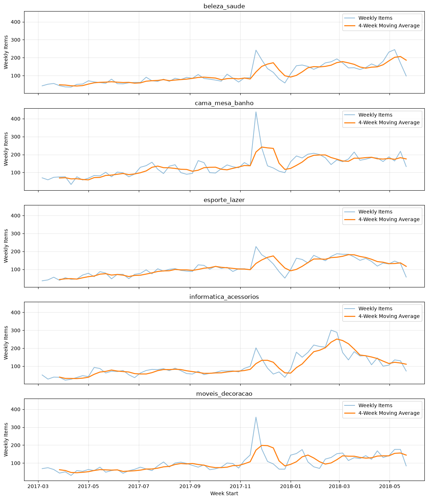
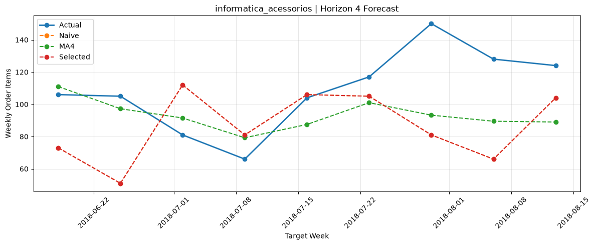
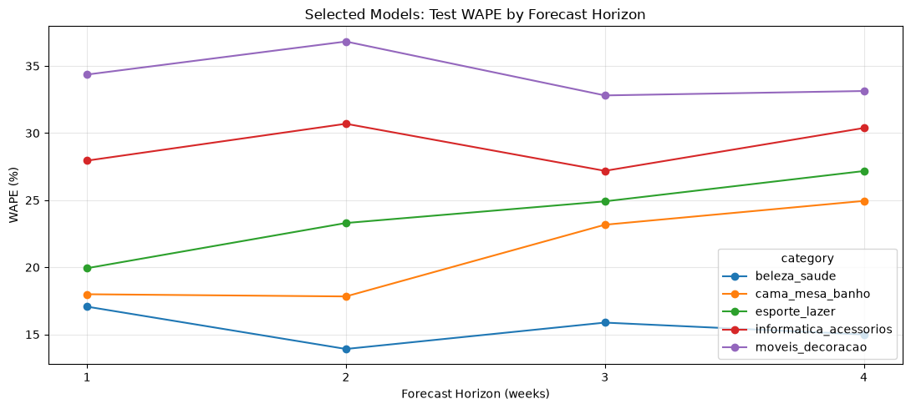

# 상품군별 주간 수요예측 — 분석 보고서

## 1. 분석 목적

Olist 전자상거래 데이터에서 주요 상품군의 주간 주문 상품 수량을 예측하고, 상품군별로 적합한 예측 방법이 다른지 검토한다.

본 프로젝트의 분석 질문은 다음과 같다.

1. 상품군별 주간 주문량에 어떤 추세와 변동이 존재하는가?
2. ETS·ARIMA가 Naive·이동평균보다 우수한가?
3. 예측 시차(1~4주)에 따라 모델 성능이 달라지는가?
4. 내부 검증에서 선택한 모델의 성능이 미사용 테스트 기간에도 유지되는가?
5. 예측오차가 크게 발생하는 시점에는 어떤 특징이 있는가?

## 2. 데이터 정의

| 항목 | 정의 |
|---|---|
| 데이터 | Olist Brazilian E-Commerce Dataset |
| 분석 단위 | 상품군 × 주 |
| 예측 대상 | 주간 주문 상품 수량 (`weekly_items`) |
| 분석 상품군 | 5개 |
| 분석 기간 | 2017-03-06 ~ 2018-08-13 |
| 관측 기간 | 상품군별 76주 |
| 총 관측값 | 380개 |

분석 대상 상품군은 `beleza_saude`, `cama_mesa_banho`, `esporte_lazer`, `informatica_acessorios`, `moveis_decoracao`이다.

주문 상태와 관계없이 주문 항목을 집계했으므로, 본 지표는 배송 완료 수량이나 확정 매출이 아니다.

[시계열 구축 SQL](../sql/01_data_validation_and_time_series.sql)은 주문 구매일을 월요일 시작 주차로 묶고 주문 상품 행을 센다. 상품군은 학습 64주에서만 항목 수 상위 5개를 선정한다. 선정 상품군과 76주 달력을 교차 결합한 뒤 실제 집계를 왼쪽 조인해 집계 없는 조합을 0으로 채운다. 원본 적재 누락도 0처럼 보일 수 있으므로 B-03에서 원천 주문 주차의 연속성을 먼저 확인한다. 결과는 `analytics.v_weekly_category_demand`로 제공한다.

## 3. 탐색적 분석

학습 64주에서 주간 수량과 4주 후행 이동평균을 비교했다. 2017-11-20 주에는 다섯 상품군 모두 전주 대비 100% 이상 증가했고, 합계는 567개에서 1,465개로 늘었다. 이 시점이 Black Friday 시기와 겹치지만, 주문 데이터만으로 증가 원인을 확인할 수 없다.

ACF에서는 대부분의 상품군에서 시차 1의 자기상관이 관측됐다. PACF도 주로 시차 1에서 신뢰구간을 벗어났다. ADF 검정은 상수항(c)과 상수·선형 추세항(ct) 두 설정을 비교했다.

| 상품군 | ADF p값(c) | ADF p값(ct) |
|---|---:|---:|
| 뷰티·건강 | 0.095575 | 0.000009 |
| 침구·욕실 | 0.000926 | 0.000007 |
| 스포츠·레저 | 0.060571 | 0.050272 |
| 컴퓨터·주변기기 | 0.139691 | 0.161519 |
| 가구·장식 | 0.002117 | 0.000094 |

스포츠·레저와 컴퓨터·주변기기는 두 설정에서 단위근 귀무가설을 기각하지 못했다. 검정 결과는 차분 후보를 검토하는 데 활용했으며 차분 차수는 예측 성능과 함께 비교했다.

## 4. 모델 및 검증 방법

### 4.1 비교 모델

총 13개 모델을 비교했다.

- Baseline: Naive, MA4
- ETS: ETS(A,N,N), ETS(A,A,N), ETS(A,Ad,N)
- ARIMA: \(p,d,q\in\{0,1\}\)의 8개 조합

ARIMA에서 \(d=0\)인 후보는 상수항을 포함하고, \(d=1\)인 후보는 드리프트 없이 적합했다.

Naive는 직전 관측값을, MA4는 최근 4주 평균을 기준으로 삼는다. ETS는 수준·선형 추세·감쇠 추세의 차이를, ARIMA는 짧은 자기상관과 차분 여부를 비교하기 위해 사용했다. 학습 64주로 연간 계절 반복을 충분히 볼 수 없어 계절 모형은 후보에 포함하지 않았다.

### 4.2 데이터 분할

| 구간 | 기간 | 용도 |
|---|---|---|
| 최초 64주 | 2017-03-06 ~ 2018-05-21 | 모델 비교 및 선정 |
| 마지막 12주 | 2018-05-28 ~ 2018-08-13 | 최종 테스트 |

표의 날짜는 주 시작일이다. 마지막 학습 주는 2018-05-27, 마지막 테스트 주는 2018-08-19에 끝난다.

### 4.3 Rolling-origin 검증

**내부 검증**

- 최소 학습 기간: 32주
- 예측 시작점: 상품군별 29개
- 예측 Horizon: 1~4주
- 학습 구간: 예측 시작점이 이동할 때마다 확장

**최종 테스트**

- 상품군별 모델을 내부 검증 결과로 사전 선정
- 최초 64주 학습 후 매주 관측값을 추가하여 재적합
- 상품군별 9개 예측 시작점
- 각 시작점에서 향후 4주 예측

테스트 구간에서 새롭게 관측된 데이터는 이후 예측의 학습에 사용했지만, 테스트 성능을 이용해 모델 종류를 다시 선정하지는 않았다.

## 5. 평가 지표

### MAE

\[
MAE=\frac{1}{n}\sum_{i=1}^{n}|y_i-\hat y_i|
\]

예측오차의 평균 절댓값으로, 주문 상품 개수 단위에서 해석할 수 있다.

### WAPE

\[
WAPE=\frac{\sum_i|y_i-\hat y_i|}{\sum_i|y_i|}\times100
\]

실제 주문량 합계에 대한 절대오차 합계의 비율이다.

모델 선정에는 29개 시작점 × 4개 시차의 절대오차 합과 실제값 합으로 계산한 통합 WAPE를 사용했다. 시차별 WAPE의 단순평균과는 집계 방식이 다르다. 테스트도 모델 역할별 9개 시작점 × 4개 시차를 같은 방식으로 집계했다.

Rolling-origin 평가에서는 같은 실제 관측 주가 서로 다른 예측 시작점에서 반복 등장할 수 있다. 따라서 동일 목표 주라도 시작점이나 시차가 다르면 예측을 보존했다. 중복 검증 키는 상품군·모델·예측 시작 주·시차다. CSV의 Selected는 내부 검증에서 고정한 모델의 역할 표기이며, 같은 알고리즘의 기준선 행과 함께 표시할 경우 별도 예측으로 해석하지 않는다.

## 6. 상품군별 모델 선정

내부 검증에서 상품군별 통합 WAPE가 가장 낮은 모델을 선정했다.

| 상품군 | 선정 모델 | 내부 검증 WAPE |
|---|---|---:|
| 뷰티·건강 | ETS(A,A,N) | 22.56% |
| 침구·욕실 | ETS(A,Ad,N) | 23.71% |
| 스포츠·레저 | ETS(A,A,N) | 23.06% |
| 컴퓨터·주변기기 | Naive | 36.49% |
| 가구·장식 | MA4 | 35.51% |

컴퓨터·주변기기의 내부 검증에서 ARIMA(0,1,0)이 최우수였으나, 해당 설정의 예측값이 Naive와 동일함을 검증했다. 이에 따라 단순한 Naive를 선택했다.

## 7. 최종 테스트 결과

| 상품군 | 선정 모델 | Naive WAPE | 선정 모델 WAPE | 상대 개선율 |
|---|---|---:|---:|---:|
| 뷰티·건강 | ETS(A,A,N) | 25.69% | 15.43% | +39.93% |
| 침구·욕실 | ETS(A,Ad,N) | 30.20% | 21.03% | +30.35% |
| 스포츠·레저 | ETS(A,A,N) | 27.99% | 23.98% | +14.32% |
| 컴퓨터·주변기기 | Naive | 29.09% | 29.09% | 0.00% |
| 가구·장식 | MA4 | 31.62% | 34.22% | -8.22% |

5개 상품군 중 3개에서 Naive 대비 WAPE가 감소했으며, 1개는 동일하고 1개는 증가했다.

특히 뷰티·건강과 침구·욕실은 선정된 ETS 모델이 Naive뿐 아니라 MA4보다도 낮은 테스트 WAPE를 기록했다.

## 8. 예측 실패 사례

### 8.1 컴퓨터·주변기기

내부 검증에서는 Naive가 우수했지만, 테스트 구간에서는 MA4의 WAPE가 22.34%로 Naive의 29.09%보다 낮았다.

2018-07-30의 실제 주문량은 150개였지만 4주 후 예측값은 다음과 같았다.

| 모델 | 예측값 | 과소예측 수량 |
|---|---:|---:|
| Naive | 81 | 69 |
| MA4 | 93.25 | 56.75 |

Naive는 마지막 관측값에 민감한 반면, MA4는 최근 관측값을 평균하여 일부 큰 오차를 줄였다.

그러나 MA4 역시 급격한 수요 증가를 충분히 포착하지 못했다.

2018-07-30 주의 예측 기준일은 2018-07-02 주 시작일이다. 두 모델 모두 과거 주문량만 사용해 해당 주의 증가 폭을 충분히 반영하지 못했다. 프로모션 일정, 가격 변화, 재고·품절 자료가 없어 급증 원인이나 이 정보를 추가했을 때의 개선 효과는 확인하지 못했다. 향후에는 예측 시점에 확보 가능한 정보만 사용하고, 유사 행사가 여러 차례 관측된 자료에서 동일한 Rolling-origin 설계로 외생변수 추가 전후의 오차를 비교한다.

### 8.2 가구·장식

내부 검증에서는 MA4가 최우수였지만, 테스트에서는 Naive의 WAPE가 더 낮았다.

이는 상품군별 모델의 상대적 우위가 평가 기간에 따라 달라질 수 있음을 보여준다.

## 9. Horizon별 성능

선정 모델의 테스트 WAPE(%)는 다음과 같다. 시차별 9개 예측을 사용하며 시차마다 목표 주 범위가 다르다.

| 상품군 | 1주 | 2주 | 3주 | 4주 |
|---|---:|---:|---:|---:|
| 뷰티·건강 | 17.07 | 13.91 | 15.88 | 14.99 |
| 침구·욕실 | 17.99 | 17.83 | 23.17 | 24.94 |
| 스포츠·레저 | 19.93 | 23.30 | 24.91 | 27.17 |
| 컴퓨터·주변기기 | 27.95 | 30.69 | 27.19 | 30.38 |
| 가구·장식 | 34.36 | 36.82 | 32.81 | 33.13 |

동일한 실제 관측 주를 대상으로 Horizon 1~4를 비교하기 위해 모든 Horizon의 예측값이 존재하는 공통 6개 주를 별도로 분석했다.

- 뷰티·건강: Horizon별 WAPE 약 13~14%로 비교적 일정
- 침구·욕실: 1주 18.46%에서 4주 23.01%로 증가
- 스포츠·레저: Horizon별 성능이 불규칙하게 변화
- 컴퓨터·주변기기: 2주 예측에서 상대적으로 큰 오차
- 가구·장식: 모든 Horizon에서 비교적 높은 오차

예측 기간이 증가한다고 오차가 반드시 단조 증가하지는 않았다.

단, 공통 평가 대상이 6개 주에 불과하므로 일반적인 성능 차이로 확대 해석하지 않았다.

## 10. 비즈니스 활용 및 한계

### 활용 가능성

- 상품군별 단기 수요 수준 파악
- 1~4주 운영·발주 계획의 참고 지표
- 예측오차가 큰 상품군의 모니터링 우선순위 설정
- 단순 기준 모델 대비 통계 모델 도입 가치 평가

### 한계

1. 예측 대상은 주문 상품 수량이며 매출액이나 확정 판매량이 아니다.
2. 가격, 프로모션, 재고 및 품절 정보가 포함되지 않았다.
3. 각 상품군의 관측 기간이 76주로 제한적이다.
4. 테스트 기간은 12주이며, 평가 결과는 다른 기간에 그대로 일반화할 수 없다.
5. Rolling-origin 예측은 서로 겹치는 관측 주를 포함한다.
6. 예측오차 개선이 직접적인 재고 비용 절감으로 이어지는지는 평가하지 않았다.
7. 테스트 구간의 매주 재학습 방식은 최초 시점에서 12주를 한꺼번에 예측하는 방식과 다르다.

## 11. 결론

상품군별 주간 수요예측에서 단일한 모델이 모든 상품군에 우수한 결과를 제공하지는 않았다.

일부 상품군에서는 ETS가 Naive 대비 상당한 오차 감소를 보였으나, 다른 상품군에서는 단순 기준 모델이 더 적절했다.

또한 검증 구간에서 우수했던 모델이 테스트 구간에서도 반드시 우수하지는 않았다.

따라서 수요예측 시스템을 운영할 때는 **상품군별 모델 선택, 단순 기준 모델과의 지속적인 비교, 예측오차 모니터링**이 중요하다.

본 분석은 모델별 예측 정확도를 평가한 결과이며, 실제 재고 최적화나 사업 성과 개선을 검증한 결과는 아니다.

## 12. 검증과 재현 범위

[수요예측 성능 개요](https://public.tableau.com/views/Olist_17949206072540/sheet4) · [예측 결과 및 오차 분석](https://public.tableau.com/views/Olist_17949206072540/sheet5)

- 세 노트북은 각각 PostgreSQL 뷰를 조회하므로 다른 노트북의 메모리 변수에 의존하지 않는다. 실행 순서와 의존성은 [README](../README.md#8-실행-방법)를 참고한다.
- 기존 뷰에서 세 노트북의 코드 셀을 각각 실행했다. 내부 지표 260행과 테스트 예측 540행을 CSV와 키로 대조한 결과, 예측값과 지표의 최대 차이는 0이었다. 테스트 상세에서 유한한 수치, 중복 키 부재, 오차 부호를 확인했다.
- ETS 내부 적합 435회, ARIMA 내부 적합 1,160회, 테스트 ETS 적합 27회에서 수렴 플래그를 확인했다. 저장된 ARIMA 로그에는 총 87건의 경고가 있으며 후보를 경고만으로 제외하지 않았다. 적합 예외는 별도로 기록하고, ARIMA·ETS는 비유한 예측을 검사한다. 최종 테스트에서는 예측 길이와 유한성을 모두 검사한다.
- 테스트 실행 코드는 실제로 선정된 ETS·Naive·MA4를 지원한다. 데이터나 설정을 바꾸어 동등성 처리 대상 외의 ARIMA가 선택될 경우 테스트 분기 추가가 필요하다. 이번 결과의 모델 또는 선택 기준은 변경하지 않았다.
- [내부 모델 비교 CSV](../outputs/forecast_model_comparison.csv)는 상품군·모델·시차별 MAE·WAPE, [테스트 상세 CSV](../outputs/forecast_test_detail.csv)는 예측 시점·목표 주·역할·실제 모델·오차, [최종 요약 CSV](../outputs/forecast_final_summary.csv)는 통합 지표와 기준선 대비 개선율을 담는다. CSV는 기존 Tableau 입력 파일이며 현재 Notebook에는 CSV 자동 저장 셀이 없다.